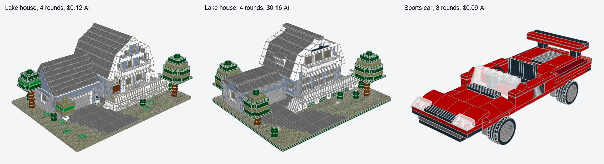

# Pip agent: 16 helpers with 310 styles

- **Date:** 2026-11-25
- **Agent:** Pip agent (`pip-agent`), on every model it offers
- **Pull request:** [#401](https://github.com/for-real-labs/brickbuilder-ai/pull/401)

## What changed

- Build scripts can call 16 helpers, each a whole ready-made piece of a model: `tree`, `roof`,
  `wall`, `window`, `door`, `arch`, `deck`, `stairs`, `railing`, `wheels`, `windscreen`, `seats`,
  `plant`, `lamp`, `chimney` and `column`. Between them they have 310 styles, at least 15 each.
  Before this, `tree` was the only helper and had 3 styles.
- The prompt's helper section is generated from the helper registry, so it always lists what
  exists. It adds about 3,500 tokens to each round's input, most of it cached after the first round.
- A helper called with arguments it does not have now answers with how it is called.

## Why

Pip lost its rounds on the same structures in every test build: tree canopies, roof slopes that
collide, steps and porch floors that are attached to nothing, wheels that are joined to nothing.
A study of customers' models (3,439 model files from generations since 2026-10-15) showed that
buildings and vehicles are 38% of what people build, and gave the exact positions of the joints
studs do not make. See [docs/fable-helpers.md](../fable-helpers.md).

## What stayed the same

- Pip's method, rounds, tools, limits and its automatic repair.
- What a helper cannot make is still built by hand: the prompt says so, and nothing stops a
  script from placing parts itself.
- The three earlier `tree` styles (`round`, `pine`, `bush`) build what they built before, so
  models saved with them rebuild the same.
- Every agent that is not a v2 agent. Their prompts do not mention helpers.

## Results

Pip on GPT-6.2 Sol, same lake house photo and prompt as earlier tests, and one text prompt for a car.

| Build | AI cost | Rounds | Minutes | Parts | Result |
|---|---|---|---|---|---|
| Lake house, before helpers (2026-11-24) | $0.18 | 5 | 3 | 988 | published |
| Lake house, helpers, first try | $0.24 | 8 | 4 | 1,132 | draft only: ran out of rounds |
| Lake house, after adding `deck`, run A | $0.20 | 6 | 3 | 1,152 | published |
| Lake house, after adding `deck`, run B | $0.14 | 5 | 2 | 1,462 | published |
| Lake house, after two fixes, run C | $0.12 | 4 | 3 | 983 | published |
| Lake house, after two fixes, run D | $0.16 | 4 | 3 | 907 | published |
| "A red sports car with a driver's seat, about 8 studs wide" | $0.09 | 3 | 1 | 112 | published |

- The first try used helpers for walls, windows, doors, roof and trees, built the raised porch by
  hand, and spent six rounds on loose parts there. That is why `deck` exists.
- Runs A and B each lost their first round to a bug: `tree()` refused arguments given by position,
  and `deck()` refused a floor one plate up. Both are fixed and tested.
- Runs C and D are the state that shipped: 4 rounds each. Two runs are not an average.
- The car used `wheels`, `windscreen` and `seats`, and its wheels, tyres and steering wheel sit
  where they should.

## Not verified

- A signed-in Pip build on the live site with helpers.
- Pip with helpers on any model other than GPT-6.2 Sol.
- Subjects other than a house and a car.
- `tests/test_fable_helpers_real.py`, which checks every style against the real parts, does not
  run in CI. It passed locally (all 310 styles) on 2026-11-25.

## Where it lives

- `backend/fable_agent/helpers/`: one module per helper family, and the registry.
- `backend/fable_agent/prompts.py`: `assisted()`, the text the v2 prompts add.
- `backend/tests/test_fable_helpers.py` and `backend/tests/test_fable_helpers_real.py`.
- `.agents/skills/fable-helpers/SKILL.md`: how to add or change a helper.
