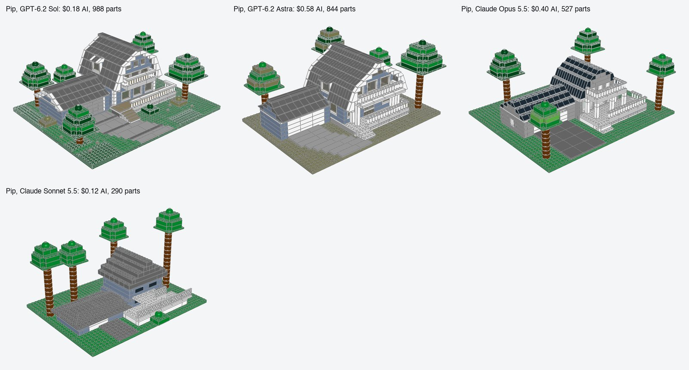

# Pip agent: Fable Lean v2 renamed, with a choice of five models

- **Date:** 2026-11-25
- **Agent:** Pip agent (`pip-agent`), replacing Fable Lean v2 · GPT-6.2 Sol (`fable-lean-v2-gpt-6.2-sol`)
- **Pull request:** [#398](https://github.com/for-real-labs/brickbuilder-ai/pull/398)

## What changed

- Fable Lean v2 · GPT-6.2 Sol is now offered as **Pip agent**, id `pip-agent`.
- When Pip is selected, Generation settings shows a **Pip agent model** list: GPT-6.2 Sol (default),
  GPT-6.2 Astra, Claude Opus 5.5, Claude Sonnet 5.5, Claude Fable 5.2.
- The backend lists the models per agent (`models` in `GET /generation-settings/building-agents`) and
  refuses a model the agent does not offer (`agent_model` on `/novaToBricks`). Each model uses
  BrickBuilder's own key for its provider.
- The model is saved in `fable-design.json`; a change to a Pip model is built with the same model.
- PostHog event `landing_agent_model_selected` records the model choice.

## Why

Requested: one agent name in the code and UI, and the ability to compare models on the same method.

## What stayed the same

- The method: lean v2 (rounds, tools, ready-made trees, automatic repair, medium effort, 8 rounds, $2).
- Access: only accounts on the Astrology allowlist see or can use Pip, as with every Fable option.
- `fable-lean-v2-gpt-6.2-sol` is no longer offered for new builds, but its id still resolves, so its
  earlier builds still open, show who built them ("Pip agent (first release)"), and can be changed.
- Every other option is unchanged.

## Results

One lake house run per model, same photo and prompt:

| Model | AI cost | Rounds | Minutes | Parts | Parts cost |
|---|---|---|---|---|---|
| GPT-6.2 Sol (default; run 2026-11-24 as Lean v2) | $0.18 | 5 | 3 | 988 | $146 |
| GPT-6.2 Astra | $0.58 | 5 | 2 | 844 | $102 |
| Claude Opus 5.5 | $0.40 | 3 | 3 | 527 | $97 |
| Claude Sonnet 5.5 | $0.12 | 3 | 1 | 290 | $63 |
| Claude Fable 5.2 | not run | | | | |

All four published with clean reports and used `tree()`. Sonnet's house is much smaller and plainer.

## Not verified

- Pip on Claude Fable 5.2 (lean v1 on that model cost $0.90).
- A signed-in Pip build on the live site.

## Where it lives

- `backend/src/utils/building_agents.py`: `PIP_AGENT`, `PIP_MODELS`, `FableVariant.using`, `RETIRED_AGENTS`.
- `backend/src/requests/fableToBricks.py`: model resolution and saving.
- `backend/src/requests/novaToBricks.py`: `agent_model` validation.
- `frontend/src/pages/LandingPage.tsx` and `frontend/src/utils/buildingAgents.ts`: the model list.
