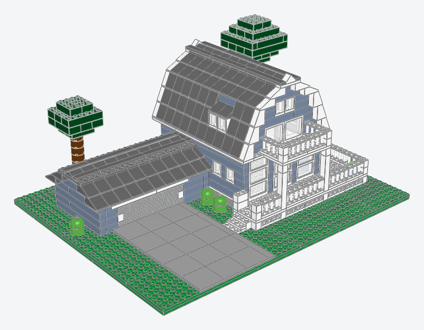

# Fable building agent

Fable is a from-scratch replacement candidate for the Nova "All parts" agent. It
turns a prompt and an optional reference photo into an LDraw model made only of
parts the supplier stocks. Nova was the reference for what the job is; none of its
code is used.

**Status:** it runs from the command line, and on the website as extra **Building
agent** options for the accounts on the Astrology allowlist. Nova stays the default
for everyone else. It has not yet been exercised in the deployed API container: the
website path is covered by tests, and the first staging build is the real check.

| | Nova | Fable |
|---|---|---|
| Where it lives | Two pinned external forks, built into a multi-GB Docker image | `backend/fable_agent`, plain Python in this repository |
| What it needs to run | Docker, LeoCAD, the full LDraw library, optional Jev search key | The backend's Python environment, an LDraw library, LeoCAD for pictures |
| How the model builds | Shell, Python and a large CLI, guided by a dozen manuals it reads first | One build script written against a small kit, plus eight tools |
| Placement | Raw LDraw origins and matrices | A stud grid; the kit measures each part from the library |
| Physical checks | A CLI the model chooses to run | Run on every script change; `finish` is refused until they pass |
| Parts inventory | Palette pushed into Nova | The same `PartsCatalog`, enforced in every build report |
| Models | One provider per deployment | Claude or OpenAI models, chosen per run with `--model` |
| Default AI budget | $20 per generation | $8 per thorough run, $2 per lean run, enforced before each call |

## Example

Built unattended by `claude-fable-5-2` with the thorough method, from a customer photo
of a lake house and the one-line prompt "Build my lake house from this photo." The
run took 8 model turns and $3.65 of AI spend, and published a model of 572 parts in 81
part/color lots, about $90 of parts at catalog prices. Every part is in the supplier
catalog, nothing overlaps, and every part is attached. A follow-up `edit` on that
session ("Make the roof dark red and add a chimney.") took 2 more model turns and
$1.22.




The script the agent wrote is kept, unedited, as
[`backend/fable_agent/examples/lakehouse.py`](../backend/fable_agent/examples/lakehouse.py).
Rebuild, check and render it without any model call:

```sh
cd backend
python -m fable_agent script fable_agent/examples/lakehouse.py --out /tmp/lakehouse
```

## Two methods, several models

A build runs with one of two methods. Both use the same kit, checks, renderer and
publish gate; they differ in how the model is asked to work.

- **Thorough** (the default) is one growing conversation. The model has eight tools
  and uses them as often as it likes: look a part up, edit, render, zoom in. Its
  reasoning carries from turn to turn. It gives the most detail, and it is what costs:
  most of the Claude run above went on deep planning, and each OpenAI run took almost
  forty turns.
- **Lean** is a few short, stateless rounds. Each round the model sees only the
  request, the current script, its build report and three pictures of it, and takes
  one action: `build`, `patch` (many edits at once), `look_up` or `finish`. Every
  script change is checked and rendered at once, so there is no separate render turn.
  A short note the model writes to itself is its only memory. Its prompt lists the
  measured size and facing of every part on the catalog sheet, so lookups are rare,
  and it runs at medium effort with at most 8 rounds and $2.

The stateless round and the "act, then look at the result" loop come from Astrology,
which is reported to build a comparable house for about $0.30. What Fable keeps is its
build script and geometry checks, which is why its rounds carry more text than
Astrology's.

One run of each on the same photo and prompt:

| Method | Model | AI cost | Model turns | Minutes | Parts | Parts cost |
|---|---|---|---|---|---|---|
| thorough | `claude-fable-5-2` | $3.65 | 8 | 12 | 572 | $90 |
| thorough | `gpt-6.2-sol` | $1.20 | 39 | 12 | 1,161 | $177 |
| thorough | `gpt-6.1-sol` | $0.62 | 38 | 13 | 1,437 | $204 |
| lean | `claude-fable-5-2` | $0.90 | 2 | 3 | 415 | $78 |
| lean, `--effort low` | `claude-fable-5-2` | $0.53 | 2 | 3 | 427 | $84 |
| lean | `gpt-6.1-sol` | $0.18 | 6 | 3 | 932 | $135 |


All six published with a clean report. These are single runs, so they show cost and
character, not an average: Claude builds a compact model and gets it right early, the
OpenAI models build larger ones and take more turns, and lean trades some detail for
a quarter of the cost or less. At low effort Claude dropped the siding color and trim.
The `gpt-6.2-sol` run predates the caching fix described under Models, which would
have saved about half of its cost.

## Running it

From `backend`, with its Python dependencies installed:

```sh
python -m fable_agent build "Build my lake house from this photo" \
  --image ~/Downloads/lakehouse.jpeg --out ../output/fable-agent/lakehouse

python -m fable_agent build "A red fishing boat" --method lean --model gpt-6.1-sol \
  --out ../output/fable-agent/boat

python -m fable_agent edit ../output/fable-agent/lakehouse "Make the roof dark red"
```

It needs:

- `ANTHROPIC_API_KEY` for Claude models or `OPENAI_API_KEY` for OpenAI models, in the
  environment or `backend/.env`.
- An LDraw parts library at `$LDRAW_DIR` (default `~/ldraw`).
- LeoCAD on `PATH`, at `$LEOCAD_BIN`, or in `/Applications` on macOS.

Useful options: `--method thorough|lean`, `--model claude-fable-5-2`, `--max-parts
1500`, `--catalog other.csv`, and `--all-parts` to lift the supplier restriction.
`--effort`, `--budget` (USD) and `--max-steps` default to the method's own values:
high, $8 and 60 turns for thorough; medium, $2 and 8 rounds for lean.

`build` refuses to reuse a directory that already holds a session. `edit` continues
that session with the method and model that started it.

### Models

The model's name picks the provider. `--model claude-fable-5-2` is the default;
`claude-opus-5-5` is a cheaper Claude. Names starting with `gpt-` go to OpenAI, for
example `--model gpt-6.1-sol`. The agent loop, tools, checks and session format are the
same for both; only the client differs (`provider.py` for Claude, `openai_provider.py`
for OpenAI).

A model can be used only if `PRICES` in `backend/fable_agent/provider.py` lists it,
because the spending limit cannot be enforced without prices. Add a row to use a new
model.

OpenAI requests are stateless (`store: false`): nothing is kept in a stored OpenAI
response, and the model's reasoning is carried forward by sending each reasoning item
back as it arrived.

Prompt caching decides what a long build costs, because every step re-sends the whole
conversation. The system prompt is sent to OpenAI as a leading developer message
rather than as `instructions`: when this was written (2026-11-22), `gpt-6.2-sol` and
`gpt-6.2-astra` cached the conversation but never top-level instructions, while both
forms cached on `gpt-6.1-sol`. `cache_read_tokens` in a session's `usage` shows
whether caching is working for a model.

## On the website

With **All parts** selected, allowlisted accounts get a **Building agent** selector in
Generation settings. The backend decides who sees it
(`GET /generation-settings/building-agents`) and checks the same allowlist again when
a build is requested, so hiding the selector is not what protects it.

| Option | Method | Model |
|---|---|---|
| Fable · Claude Fable 5.2 | thorough | `claude-fable-5-2` |
| Fable · GPT-6.2 Sol | thorough | `gpt-6.2-sol` |
| Fable · GPT-6.1 Sol | thorough | `gpt-6.1-sol` |
| Fable Lean · Claude Fable 5.2 | lean | `claude-fable-5-2` |
| Fable Lean · Claude Fable 5.2 (low effort) | lean, low effort | `claude-fable-5-2` |
| Fable Lean · GPT-6.1 Sol | lean | `gpt-6.1-sol` |

The options are defined once in `backend/src/utils/building_agents.py`, with their
labels in `frontend/src/utils/buildingAgents.ts`.

- **Access** is the Astrology allowlist, `ASTROLOGY_ALLOWED_EMAILS`. A signed-in
  account on it may use every option; nobody else can, including through the API.
- **Billing** follows the other All parts engines: BrickBuilder credits and
  BrickBuilder's own `ANTHROPIC_API_KEY` or `OPENAI_API_KEY`. Personal provider keys
  and local provider connections are refused. Each model call is reported to the
  generation's usage record.
- **Limits:** 1,000 pieces unless the request sets another limit, 5,000 at most. A
  customer's own parts inventory is refused for now; Fable builds from the catalog.
- **Results** use the standard viewer, parts list, preview and instructions. The build
  script is saved with the generation as `fable-design.json`.
- **Edits** to a Fable model go back to the option that built it, start from the saved
  script, and are open only to the model's owner.
- **Cancelling** a generation stops the agent at its next step.
- **Load:** at most three builds run at once (`FABLE_MAX_CONCURRENT_BUILDS`), on their
  own worker threads so they cannot starve the rest of the API. A few more wait their
  turn, and beyond that a request is refused with a "busy" message.
- **Time:** after 30 minutes no new model call starts and the last clean revision is
  delivered. A build still running 15 minutes later is abandoned.
- **Isolation:** build scripts run under a separate unprivileged account; see Safety.
- **Failure:** if no revision passes the checks, the generation fails with a message.
  If the agent runs out of rounds or budget after a clean revision, that revision is
  delivered.

`backend/src/requests/fableToBricks.py` is the whole integration. The build itself
runs in a scratch directory that is deleted afterwards.

## How a build works

1. The model receives the request, the reference photo, a frozen system prompt and
   a parts sheet generated from the catalog: the most widely stocked parts in each
   category and every available color.
2. It writes a **build script**. The script is the model's source of truth; every
   change to the model is a change to the script.
3. Each `write_script` or `edit_script` call runs the script, then returns a
   **build report**: part count, size, overlapping parts, unattached parts,
   unavailable part/color pairs and an estimated parts cost.
4. It calls `render` to look at the build from any side, or zoomed on a region.
5. `finish` publishes. The harness refuses it while the report has errors or the
   current revision has not been rendered.

If a run hits its step or budget limit first, the last error-free revision is saved
as a **draft** rather than lost. A model refusal ends the run without publishing.

### Tools

`search_parts`, `inspect_part`, `view_parts`, `write_script`, `edit_script`,
`read_script`, `render`, `finish`. There is no shell, no file access and no network
tool.

`inspect_part` answers from measured geometry rather than from memory: footprint,
height, a height map that shows which way a slope faces, stud positions and
available colors.

### The build script

Scripts use a stud grid: `x` to the right and `z` to the back in studs, `y` up in
plates. A placement names the min corner of the part's footprint and the height of
its base. The kit works out the LDraw origin and matrix.

```python
module("walls")
door = rect(5, 0, 7, 1)
for course in range(5):
    cells = ring(0, 0, 12, 8) - (door if course < 4 else set())
    fill(cells, 1 + 3 * course, "Sand_Blue")          # bonded brick courses
frame = place("60592", "White", 2, 4, 0)              # a window
inset("60601", "Trans_Clear", frame)                  # its glass
row("3039", "Dark_Bluish_Grey", 0, 16, 0, 6, facing="front")   # a course of roof slopes
```

`fill` packs cells with the largest available bricks, plates or tiles in that color
and staggers seams between layers so walls bond and ring corners interlock.
`facing` aims a slope's low edge without the model reasoning about rotation
matrices. The full list is in `SYSTEM` in `backend/fable_agent/prompts.py`.

The steps above describe the thorough method. In the lean method steps 3 and 4 are
one: `build` and `patch` return the report and pictures together.

## What a session contains

```
session.json      frozen system prompt and tool list, settings, usage, status
transcript.json   the append-only conversation (pictures are file references)
reference.jpg     bounded, re-encoded copy of the customer's picture
build.py          current script;  scripts/NNN.py holds every revision
model.ldr         current build;   report.json holds its checks
renders/          every picture the model looked at
published/001/    model.ldr, build.py, bom.csv, report.json, preview.png, four views
```

The transcript is never edited. A model's reasoning is valid only against the exact
system prompt, tool list and history that produced it, so a session keeps its own
copy of the prompt and tools and only ever appends. This also keeps the provider's
prompt cache warm from one step to the next.

A lean session keeps the same files. Its transcript is a record of each round and is
never sent back to the model; what carries over is in `session.json` under `lean`:
the brief, the model's note, looked-up part facts and the latest pictures.

## What the checks prove

The report covers part availability and quantity limits, overlapping parts,
stud-to-part connections, parts that float, and separate free-standing assemblies.
Part shapes are sampled from library geometry in half-stud columns, so slopes,
inverted slopes, arches and panels are checked against their real profile.

It does not cover clips, bars, hinges, balance, or whether a hand can reach a part.
Parts on rotations that are not multiples of 90 degrees are not overlap-checked.
Reports say this, and every report carries `physical_validity: not_proven`.
When Fable is wired into the site, its models should go through the existing
supplier and instruction checks before a customer is charged, as Nova's do.

## Safety

A build script is code the model wrote from a customer's request, so it is treated as
untrusted. Three barriers stand between it and the rest of the system.

- **A restricted dialect.** Imports other than `math` and `random`, classes,
  underscore and frame attributes, `str.format`, and builtins that reach files or the
  interpreter are rejected before execution.
- **A separate process** with a scrubbed environment (no API keys), an empty working
  directory, and limits it places on itself before it reads the script: CPU time,
  memory, file size, open files and process count, plus a wall-clock timeout.
- **A separate operating-system account.** On a server the process runs as an
  unprivileged account that owns nothing. It can read the parts library and the shape
  cache and cannot read the API's environment, where every secret lives, or write
  anywhere the API trusts. The API image creates this account (`fable-sandbox`) and
  names it in `FABLE_SANDBOX_USER`.

The third barrier fails closed. Root never runs a script itself; if the named account
is missing or the process cannot switch to it, no script runs. The API checks each
result came from that account and discards it otherwise. On the website Fable answers
"temporarily unavailable" unless scripts run under a separate account; only an offline
local checkout, whose one user is the developer, may run them as the caller. From the
command line on your own machine, scripts run as you.

What this does not give: the script process shares the API container's CPU, memory and
network. A script that got past the dialect could still make outbound connections or
slow the container until its limits stop it. A separate service, as Nova has, removes
that too and is the stronger design if Fable becomes a main path.
- **Spending is capped per run.** Before each call the remaining budget must cover
  the whole context at the highest input rate; the rest bounds output tokens.
  Unknown models and missing usage fail closed.
- **Reference pictures** are re-encoded, which drops EXIF such as GPS position.
  They are sent to the model provider, as with the other generation modes.
- **API keys** are read from the environment, sent only to their own provider, and
  never written to a session, a log or an error message.
- Supplier prices and SKUs never reach the model: it sees only which part/color
  pairs exist.

## Not done yet

- The website path has not run in the deployed container. It relies on the LeoCAD
  and LDraw installation Astrology uses there.
- Fable's build scripts run under their own account but in the API's container, so
  they share its CPU, memory and network. See Safety for what that leaves open.
- On the website an edit starts from the saved script, not from the conversation that
  wrote it, and a customer's parts inventory is not supported.
- Instruction steps are grouped by height. The existing connected-step planner
  should run on published models, as it does for Nova.
- Doors hung in frames and other clip or hinge connections are placed by `inset`
  or `connect` and are not verified.

## Tests

```sh
cd backend
uv run --group dev pytest tests/test_fable_agent_*.py tests/test_fable_web.py
```

The tests build a tiny synthetic LDraw library, so they need no parts library,
renderer or network. The frontend's selector is covered by
`frontend/tests/landing-page.test.tsx` and `frontend/tests/building-agents.test.ts`.
