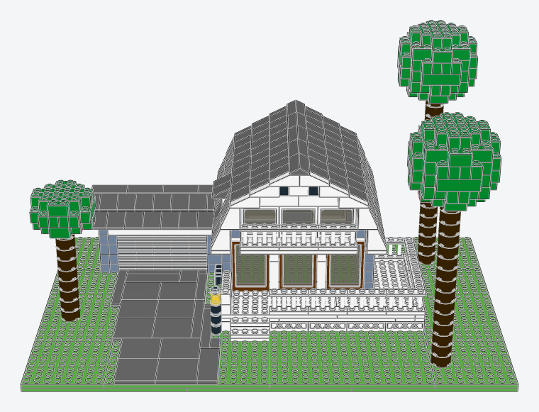
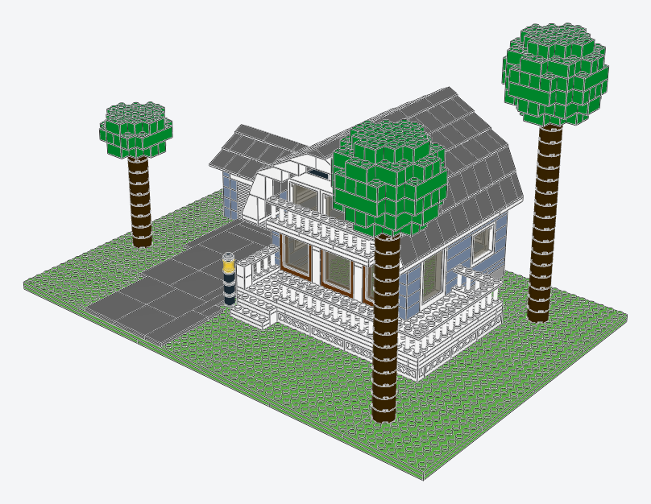
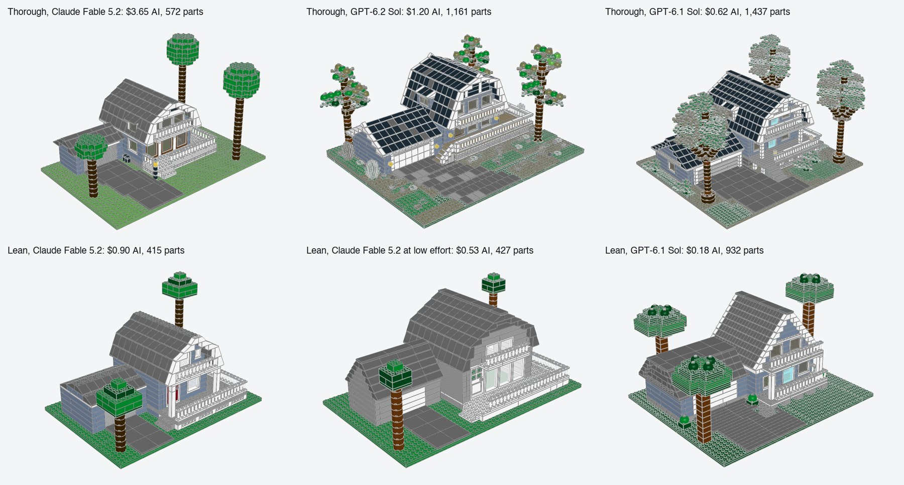

# Fable building agent

Fable is a from-scratch replacement candidate for the Nova "All parts" agent. It
turns a prompt and an optional reference photo into an LDraw model made only of
parts the supplier stocks. Nova was the reference for what the job is; none of its
code is used.

**Status:** it runs from the command line, and on the website as extra **Building
agent** options for the accounts on the Astrology allowlist. Nova stays the default
for everyone else. Its build, check and render path and its script isolation were
verified inside the API image built for production's platform; the website request
path is covered by tests. A generation through the deployed site is the last check.

| | Nova | Fable |
|---|---|---|
| Where it lives | Two pinned external forks, built into a multi-GB Docker image | `backend/fable_agent`, plain Python in this repository |
| What it needs to run | Docker, LeoCAD, the full LDraw library, optional Jev search key | The backend's Python environment, an LDraw library, LeoCAD for pictures |
| How the model builds | Shell, Python and a large CLI, guided by a dozen manuals it reads first | One build script written against a small kit, plus eight tools |
| Placement | Raw LDraw origins and matrices | A stud grid; the kit measures each part from the library |
| Physical checks | A CLI the model chooses to run | Run on every script change; `finish` is refused until they pass |
| Parts inventory | Palette pushed into Nova | The same `PartsCatalog`, enforced in every build report |
| Models | One provider per deployment | Claude or OpenAI models, chosen per run with `--model` |
| Default AI budget | $20 per generation | $8 per thorough run, $2 per lean run, enforced before each call |

## Example

Built unattended by `claude-fable-5-2` with the thorough method, from a customer photo
of a lake house and the one-line prompt "Build my lake house from this photo." The
run took 8 model turns and $3.65 of AI spend, and published a model of 572 parts in 81
part/color lots, about $90 of parts at catalog prices. Every part is in the supplier
catalog, nothing overlaps, and every part is attached. A follow-up `edit` on that
session ("Make the roof dark red and add a chimney.") took 2 more model turns and
$1.22.





The script the agent wrote is kept, unedited, as
[`backend/fable_agent/examples/lakehouse.py`](../backend/fable_agent/examples/lakehouse.py).
Rebuild, check and render it without any model call:

```sh
cd backend
python -m fable_agent script fable_agent/examples/lakehouse.py --out /tmp/lakehouse
```

## Two methods, several models

A build runs with one of two methods. Both use the same kit, checks, renderer and
publish gate; they differ in how the model is asked to work.

- **Thorough** (the default) is one growing conversation. The model has eight tools
  and uses them as often as it likes: look a part up, edit, render, zoom in. Its
  reasoning carries from turn to turn. It gives the most detail, and it is what costs:
  most of the Claude run above went on deep planning, and each OpenAI run took almost
  forty turns.
- **Lean** is a few short, stateless rounds. Each round the model sees only the
  request, the current script, its build report and three pictures of it, and takes
  one action: `build`, `patch` (many edits at once), `look_up` or `finish`. Every
  script change is checked and rendered at once, so there is no separate render turn.
  A short note the model writes to itself is its only memory. Its prompt lists the
  measured size and facing of every part on the catalog sheet, so lookups are rare,
  and it runs at medium effort with at most 8 rounds and $2.

Each method has a second version, **thorough v2** and **lean v2**. They are separate
methods so that the first versions keep behaving exactly as they did, and so the two
can be compared. Both add two things:

- **Helpers.** Scripts can call `tree()`, `roof()`, `wall()`, `window()`, `door()`,
  `arch()`, `deck()`, `stairs()`, `railing()`, `wheels()`, `windscreen()`, `seats()`,
  `chassis()`, `furniture()`, `plant()`, `lamp()`, `chimney()` and `column()` for a whole,
  ready-made piece of the model in one of 381 styles. Models lost most of their turns on these structures, so the kit
  builds them from parts that are known to fit together. What no style can make is
  still built by hand. See [docs/fable-helpers.md](fable-helpers.md).
- **Automatic repair.** Before a build is checked, a plain brick, plate or tile that
  runs into another part is cut back to its free cells, a part the catalog does not
  stock is replaced by the same mould under another number or by a stocked part that
  measures the same (outline, height, studs and surfaces; `backend/fable_agent/stock.py`),
  and a part asked for in a color it is not sold in gets the closest color it is sold
  in. A part with no safe stand-in stays an error. The report says what was repaired. Shaped parts are never cut, nothing is moved, parts built sideways
  and unattached parts are left to the model, and the repaired build still goes
  through every check (`backend/fable_agent/repair.py`).

- **Building guides.** The v2 prompts carry four short guides on design, vehicles,
  spacecraft and joints that are not studs. They are adapted from the Nova toolkit's
  agent guides and live in `backend/fable_agent/guides/` (CC BY-SA 4.0), about 6,500
  characters together.

Thorough v2 is also asked to take fewer turns. Its prompt carries the measured size
and facing of every part on the catalog sheet, as lean's does, `inspect_part` takes
up to 12 parts at once, `edit_script` takes a list of replacements, and the model is
told that calls in one turn run in order, so an edit and the render of its result can
go together.

The stateless round and the "act, then look at the result" loop come from Astrology,
which is reported to build a comparable house for about $0.30. What Fable keeps is its
build script and geometry checks, which is why its rounds carry more text than
Astrology's.

One run of each on the same photo and prompt:

| Method | Model | AI cost | Model turns | Minutes | Parts | Parts cost |
|---|---|---|---|---|---|---|
| thorough | `claude-fable-5-2` | $3.65 | 8 | 12 | 572 | $90 |
| thorough | `gpt-6.2-sol` | $1.20 | 39 | 12 | 1,161 | $177 |
| thorough v2 | `gpt-6.2-sol` | $0.46 | 15 | 9 | 1,282 | $164 |
| thorough | `gpt-6.1-sol` | $0.62 | 38 | 13 | 1,437 | $204 |
| lean | `claude-fable-5-2` | $0.90 | 2 | 3 | 415 | $78 |
| lean, `--effort low` | `claude-fable-5-2` | $0.53 | 2 | 3 | 427 | $84 |
| lean | `gpt-6.2-sol` | $0.22 | 5 | 4 | 1,073 | $147 |
| lean v2 (Pip) | `gpt-6.2-sol` | $0.18 | 5 | 3 | 988 | $146 |
| lean v2 (Pip) | `gpt-6.2-astra` | $0.58 | 5 | 2 | 844 | $102 |
| lean v2 (Pip) | `claude-opus-5-5` | $0.40 | 3 | 3 | 527 | $97 |
| lean v2 (Pip) | `claude-sonnet-5-5` | $0.12 | 3 | 1 | 290 | $63 |
| lean | `gpt-6.1-sol` | $0.18 | 6 | 3 | 932 | $135 |



All twelve published with a clean report. These are single runs, so they show cost and
character, not an average: Claude builds a compact model and gets it right early, the
OpenAI models build larger ones and take more turns, and lean trades some detail for
about a quarter of the cost. At low effort Claude dropped the siding color and trim.
Lean on `gpt-6.2-sol` kept the roof shape, dormer and lattice skirt but laid an olive
ground instead of a green lawn. The thorough `gpt-6.2-sol` run predates the caching
fix described under Models, which would have saved about half of its cost.

The two v2 runs planted every tree with `tree()`. Thorough v2 took 15 turns where the
first version took 39, and 4 script revisions where it took 27. Against the first
version's cost with the caching fix (about $0.60, estimated) that is roughly a quarter
cheaper: fewer turns, but each one writes more. Lean v2 still took 5 rounds, because
its drafts had errors the repair leaves alone (unattached steps, a part built
sideways), so its saving came from smaller rounds. The details are in
[docs/agent-changes](agent-changes/README.md).

## Running it

From `backend`, with its Python dependencies installed:

```sh
python -m fable_agent build "Build my lake house from this photo" \
  --image ~/Downloads/lakehouse.jpeg --out ../output/fable-agent/lakehouse

python -m fable_agent build "A red fishing boat" --method lean --model gpt-6.1-sol \
  --out ../output/fable-agent/boat

python -m fable_agent edit ../output/fable-agent/lakehouse "Make the roof dark red"
```

It needs:

- `ANTHROPIC_API_KEY` for Claude models or `OPENAI_API_KEY` for OpenAI models, in the
  environment or `backend/.env`.
- An LDraw parts library at `$LDRAW_DIR` (default `~/ldraw`).
- LeoCAD on `PATH`, at `$LEOCAD_BIN`, or in `/Applications` on macOS.

Useful options: `--method thorough|thorough-v2|lean|lean-v2`, `--model claude-fable-5-2`, `--max-parts
1500`, `--catalog other.csv`, and `--all-parts` to lift the supplier restriction.
`--effort`, `--budget` (USD) and `--max-steps` default to the method's own values:
high, $8 and 60 turns for thorough; medium, $2 and 8 rounds for lean. The v2 methods
use the limits of their first versions.

`--examples` (v2 methods) shows the model the example builds closest to the request
first; see [Example builds](#example-builds).

`python -m fable_agent script build.py --out DIR --repair` rebuilds a v2 model's script
the way the v2 methods do, with the automatic repair applied first.

`build` refuses to reuse a directory that already holds a session. `edit` continues
that session with the method and model that started it.

### Models

The model's name picks the provider. `--model claude-fable-5-2` is the default;
`claude-opus-5-5` is a cheaper Claude. Names starting with `gpt-` go to OpenAI, for
example `--model gpt-6.1-sol`. The agent loop, tools, checks and session format are the
same for both; only the client differs (`provider.py` for Claude, `openai_provider.py`
for OpenAI).

A model can be used only if `PRICES` in `backend/fable_agent/provider.py` lists it,
because the spending limit cannot be enforced without prices. Add a row to use a new
model.

OpenAI requests are stateless (`store: false`): nothing is kept in a stored OpenAI
response, and the model's reasoning is carried forward by sending each reasoning item
back as it arrived.

Prompt caching decides what a long build costs, because every step re-sends the whole
conversation. The system prompt is sent to OpenAI as a leading developer message
rather than as `instructions`: when this was written (2026-11-22), `gpt-6.2-sol` and
`gpt-6.2-astra` cached the conversation but never top-level instructions, while both
forms cached on `gpt-6.1-sol`. `cache_read_tokens` in a session's `usage` shows
whether caching is working for a model.

## On the website

With **All parts** selected, allowlisted accounts get a **Building agent** selector in
Generation settings. The backend decides who sees it
(`GET /generation-settings/building-agents`) and checks the same allowlist again when
a build is requested, so hiding the selector is not what protects it.

| Option | Method | Model |
|---|---|---|
| Fable · Claude Fable 5.2 | thorough | `claude-fable-5-2` |
| Fable · GPT-6.2 Sol | thorough | `gpt-6.2-sol` |
| Fable Thorough v2 · GPT-6.2 Sol | thorough v2 | `gpt-6.2-sol` |
| Fable · GPT-6.1 Sol | thorough | `gpt-6.1-sol` |
| Fable Lean · Claude Fable 5.2 | lean | `claude-fable-5-2` |
| Fable Lean · Claude Fable 5.2 (low effort) | lean, low effort | `claude-fable-5-2` |
| Fable Lean · GPT-6.2 Sol | lean | `gpt-6.2-sol` |
| Pip agent | lean v2 | your choice; `gpt-6.2-sol` by default |
| Fable Lean · GPT-6.1 Sol | lean | `gpt-6.1-sol` |

The **Pip agent** (`pip-agent`) is the lean v2 method with a choice of model. When it is
selected, Generation settings shows a second list with `gpt-6.2-sol` (the default),
`gpt-6.2-astra`, `claude-opus-5-5`, `claude-sonnet-5-5` and `claude-fable-5-2`. The
backend lists the models it offers (`GET /generation-settings/building-agents`) and
refuses any other. The chosen model is saved in `fable-design.json`, and a later change
to the model is built with the same one. Pip replaced Fable Lean v2 · GPT-6.2 Sol: that
option is no longer offered, but its earlier builds can still be opened and changed.


On the lake house, GPT-6.2 Sol built the most detailed model for the least. Sonnet 5.5
was cheapest but built a much smaller, plainer house; Opus 5.5 and Astra 6.2 cost two to
three times Sol's price for fewer parts. Pip on `claude-fable-5-2` has not been test-run
(lean v1 on that model cost $0.90). One run each, so these show cost and character only.

The options are defined once in `backend/src/utils/building_agents.py`, with their
labels in `frontend/src/utils/buildingAgents.ts`. A change to any agent is recorded
in [docs/agent-changes](agent-changes/README.md).

- **Access** is the Astrology allowlist, `ASTROLOGY_ALLOWED_EMAILS`. A signed-in
  account on it may use every option; nobody else can, including through the API.
- **Billing** follows the other All parts engines: BrickBuilder credits and
  BrickBuilder's own `ANTHROPIC_API_KEY` or `OPENAI_API_KEY`. Personal provider keys
  and local provider connections are refused. Each model call is reported to the
  generation's usage record.
- **Limits:** 1,000 pieces unless the request sets another limit, 5,000 at most. A
  customer's own parts inventory is refused for now; Fable builds from the catalog.
- **Results** use the standard viewer, parts list, preview and instructions. The build
  script is saved with the generation as `fable-design.json`, with the model that built it.
- **Edits** to a Fable model go back to the option that built it, start from the saved
  script, and are open only to the model's owner.
- **Cancelling** a generation stops the agent at its next step.
- **Load:** at most three builds run at once (`FABLE_MAX_CONCURRENT_BUILDS`), on their
  own worker threads so they cannot starve the rest of the API. A few more wait their
  turn, and beyond that a request is refused with a "busy" message.
- **Time:** after 30 minutes no new model call starts and the last clean revision is
  delivered. A build still running 15 minutes later is abandoned.
- **Isolation:** build scripts run under a separate unprivileged account; see Safety.
- **Failure:** if no revision passes the checks, the generation fails with a message
  and the last build is offered as an unverified draft with its failed checks, in the
  same download Nova's rejected drafts use. If the agent runs out of rounds or budget
  after a clean revision, that revision is delivered.
- **3D by default:** the request carries the product's design default
  (`build_design_guidance.py`), as Nova's does: a photo is built as a 3D model, and a
  mosaic only when it is asked for.

### Example builds

The v2 agents (Pip and Thorough v2) can be shown finished builds before they start.
It is an option, **off by default**: a checkbox in Generation settings, `use_examples` on
the request, and `--examples` on the command line.

1. The request is matched against a plain-English description of every example
   (`fable_agent/examples/retrieval.py`). A keyword search shortlists up to 300 descriptions
   that share words with the request, and [Jev](https://docs.typesafe.ai/models), a semantic
   reranker, scores how well each matches. This is how the Nova toolkit finds its references.
2. The best five that fit are added to the end of the prompt, at most two from one set, up
   to 40,000 characters (about 11,000 tokens). A whole model shows proportions and colors; a
   submodel, such as a bogie or a roof, shows how one piece is built.

Jev is a paid service reached through the `jev-rerank` command (installed in the API image)
and needs `TYPESAFE_API_KEY`. One search costs about half a cent ($0.042 per million input
tokens) and takes about five seconds; the cost is charged to the build and listed with its
model calls. When the command, the key or the service is missing, the keyword ranking is used
alone and the build's record says so (`settings.example_search` in `session.json`). A search
never stops a build.

The examples are in `backend/fable_agent/examples/library/`, one script per example and
`index.jsonl` with the descriptions:

- **Official sets** from the [LDraw Official Model Repository](https://library.ldraw.org/omr),
  each model and each described submodel on its own, with the descriptions written for the
  annotated copies in ldraw-nova.
- **The example atlases** of ldraw-nova: buildings, vehicles, spaceships and mechanisms.

An example keeps the parts its set uses, whether or not BrickBuilder stocks them, and only its
minifigures are left out. Examples are references, not builds Pip may copy: many use joints Pip's
checks cannot follow (clips, hinges, Technic parts that were not measured, parts set at an angle),
and those are marked in the prompt as using joints its report cannot verify. The prompt says the
build itself may use catalog parts only and is held to every check. `index.jsonl` records which
examples also pass the checks (`checked`). Technic models are included. Sections of fewer than 3
pieces and models of more than 1,200 pieces are left out, the first as too small to teach
anything and the second because they would not fit a prompt; a large model's sections are kept.
Files licensed for non-commercial use only are never used.

`backend/scripts/build_fable_examples.py --source <checkout>` rebuilds the library from a
local checkout of the annotated models. `NOTICE.md` and `SOURCES.md` in the folder give the
licences and credit every file, and each script repeats its own credit in its first lines.
`tests/test_fable_examples.py` checks the credits of every script and builds a spread of the
examples with the real parts under the publication rules.

`backend/src/requests/fableToBricks.py` is the whole integration. The build itself
runs in a scratch directory that is deleted afterwards.

## How a build works

1. The model receives the request, the reference photo, a frozen system prompt and
   a parts sheet generated from the catalog: the most widely stocked parts in each
   category and every available color.
2. It writes a **build script**. The script is the model's source of truth; every
   change to the model is a change to the script.
3. Each `write_script` or `edit_script` call runs the script, then returns a
   **build report**: part count, size, overlapping parts, unattached parts,
   unavailable part/color pairs and an estimated parts cost.
4. It calls `render` to look at the build from any side, or zoomed on a region.
5. `finish` publishes. The harness refuses it while the report has errors or the
   current revision has not been rendered.

If a run hits its step or budget limit first, the last error-free revision is saved
as a **draft** rather than lost. A model refusal ends the run without publishing.

### Tools

`search_parts`, `inspect_part`, `view_parts`, `write_script`, `edit_script`,
`read_script`, `render`, `finish`. There is no shell, no file access and no network
tool.

`inspect_part` answers from measured geometry rather than from memory: footprint,
height, a height map that shows which way a slope faces, stud positions and
available colors.

### The build script

Scripts use a stud grid: `x` to the right and `z` to the back in studs, `y` up in
plates. A placement names the min corner of the part's footprint and the height of
its base. The kit works out the LDraw origin and matrix.

```python
module("walls")
door = rect(5, 0, 7, 1)
for course in range(5):
    cells = ring(0, 0, 12, 8) - (door if course < 4 else set())
    fill(cells, 1 + 3 * course, "Sand_Blue")          # bonded brick courses
frame = place("60592", "White", 2, 4, 0)              # a window
inset("60601", "Trans_Clear", frame)                  # its glass
row("3039", "Dark_Bluish_Grey", 0, 16, 0, 6, facing="front")   # a course of roof slopes
```

`fill` packs cells with the largest available bricks, plates or tiles in that color
and staggers seams between layers so walls bond and ring corners interlock.
`facing` aims a slope's low edge without the model reasoning about rotation
matrices. The full list is in `SYSTEM` in `backend/fable_agent/prompts.py`; the v2
methods add the helpers, whose descriptions are generated from
`backend/fable_agent/helpers`.

The steps above describe the thorough method. In the lean method steps 3 and 4 are
one: `build` and `patch` return the report and pictures together.

## What a session contains

```
session.json      frozen system prompt and tool list, settings, usage, status
transcript.json   the append-only conversation (pictures are file references)
reference.jpg     bounded, re-encoded copy of the customer's picture
build.py          current script;  scripts/NNN.py holds every revision
model.ldr         current build;   report.json holds its checks
renders/          every picture the model looked at
published/001/    model.ldr, build.py, bom.csv, report.json, preview.png, four views
rejected/         only when no revision passed: model.ldr, parts.csv, verification.json, README.txt
```

The transcript is never edited. A model's reasoning is valid only against the exact
system prompt, tool list and history that produced it, so a session keeps its own
copy of the prompt and tools and only ever appends. This also keeps the provider's
prompt cache warm from one step to the next.

A lean session keeps the same files. Its transcript is a record of each round and is
never sent back to the model; what carries over is in `session.json` under `lean`:
the brief, the model's note, looked-up part facts and the latest pictures.

## What the checks prove

The report covers part availability and quantity limits, overlapping parts,
stud-to-part connections, parts that float, and separate free-standing assemblies.
Part shapes are sampled from library geometry in half-stud columns, so slopes,
inverted slopes, arches and panels are checked against their real profile.

In the v2 methods the automatic repair runs first and the checks then judge the
repaired build, so a repair cannot make an invalid model pass.

In the first-version methods the report does not cover clips, bars, hinges, balance, or
whether a hand can reach a part, and parts on rotations that are not multiples of 90
degrees are not overlap-checked. Reports say this, and every report carries
`physical_validity: not_proven`.

### Publication rules (the v2 methods)

Pip and Thorough v2 are held to stricter rules before a model is published. They began as
Nova's publication checks and are now the Fable agents' own code: nothing is loaded from
`backend/nova-service`, and the two can change apart.

| Rule | What it refuses | Code |
|---|---|---|
| Solid plastic | Two plain bricks, plates or tiles in the same place at any rotation, and anything that cuts into a seat back, dish rim, curved tile or side stud. `allow_overlap` does not excuse it. | `material.py`, `solids.py` |
| Measured joints | Nothing: these are found, not refused. A connector of one part seated in a connector of another counts as attached without `connect()`, and the space the two share is not called an overlap: a Technic pin or axle in a hole, a bar in a clip or a hollow stud, hinge halves, a wheel on its pin or axle, a tyre on its rim, a pane or door in its frame. | `connectors.py`, `fits.py` |
| Fit | A tyre on a rim of another size and a pane in a frame it was not made for, however well it is centred (`[fit]`). | `connectors.py` |
| Technic seating | A pin that is not centred in its holes, an axle that does not reach through a hole, two parts in one hole (`[technic]`). An axle with no stop at both ends and a single pin that leaves a pivot are warnings. | `toolkit/technic.py`, `toolkit/technic_review.py` |
| Vehicles | A tyre off the ground the others stand on and bodywork below the tyres: errors when the request is a car, truck or other wheeled vehicle, warnings otherwise (`[vehicle]`). Warnings: a part inside the space a tyre turns in (measured on the part's real surface), an axle that is not a mirrored pair, and a plane or boat that is not a mirror image left to right. The kind of vehicle is read from the request's words. | `vehicle.py`, `toolkit/vehicle_review.py` |
| Declared joints | A `connect()` between parts that do not touch, between parts whose seats do not fit, or a Technic pin or axle that is in none of the other part's holes. | `joints.py` |
| One model | Free-standing pieces. They were a warning; a model needs one building order. | `assembly.py` |
| Building order | A model that cannot be built one piece at a time: each piece must attach to what is already built, must not be closed in first, and must go onto an axle before parts sit on both sides of its place. | `sequence.py` |

A build that passes gets its instructions from the planner: the pieces on the ground first,
then upward, in steps of at most five connected pieces. A piece that hangs under its support is
shown as built together with it (`0 !BRICKBUILDER BUILD_TOGETHER`, which the instruction viewer
already reads). `step()` and `module()` only suggest where steps break.

Joints are measured from connector data first. `backend/fable_agent/data/shadow/` is Pip's own
copy of the LDCad shadow library, which names the connectors of about 4,600 parts: studs, clips
and bars, pins and axles with their holes, hinge fingers, and the seats of tyres, panes and
doors with the groups that say which fits which. `connectors.py` reads it with the
[pyldraw3](https://github.com/hbmartin/pyldraw3) library. For 51 Technic parts the holes and
grips were measured by hand (`toolkit/data/technic-parts.json`); those are used instead, and
each is tied to the geometry they were measured on. A part a later release of the parts library
redraws is still recognised when its outline (within 0.6 LDU) and its holes match what was
recorded in `toolkit/data/technic-sizes.json`; otherwise its checks are off and the report says
how many parts that is. `Kit.inset()` puts a
pane or door on the seat the data gives (`data/shadow/seats.json`).

Only seats prove a misfit: a tyre whose rim is not the size of any rim it is sold on, a pane
whose group is not the frame's. A pin or bar beside a hole it could fit is left to the other
checks. Where the data knows nothing about a part, `fits.py` still measures the joint from the
part's shape, as before: a peg and a hole of the same radius on one line.

The code in `toolkit/` was copied from the Nova toolkit and is licensed AGPL-3.0; the connector
data is CC BY-SA 4.0. See the [README](../README.md#license). Pip imports nothing from the Nova
service or its toolkit, and a test keeps it that way.

What this still does not prove: a frame the data has no seat for (the 1 x 4 x 3 window and
some doors) and a trolley wheel in its holder are still declared and checked for touching only;
the report counts them. A measured joint says the parts line up, not that the joint is strong
enough. Strength, balance and whether a hand can reach a part are not checked.

When no revision passes, the last build is kept in `rejected/` with its failed checks, and the
website offers it as an unverified draft.

## Safety

A build script is code the model wrote from a customer's request, so it is treated as
untrusted. Three barriers stand between it and the rest of the system.

- **A restricted dialect.** Imports other than `math` and `random`, classes,
  underscore and frame attributes, `str.format`, and builtins that reach files or the
  interpreter are rejected before execution.
- **A separate process** with a scrubbed environment (no API keys), an empty working
  directory, and limits it places on itself before it reads the script: CPU time,
  memory, file size, open files and process count, plus a wall-clock timeout.
- **A separate operating-system account.** On a server the process runs as an
  unprivileged account that owns nothing. It can read the parts library and the shape
  cache and cannot read the API's environment, where every secret lives, or write
  anywhere the API trusts. The API image creates this account (`fable-sandbox`) and
  names it in `FABLE_SANDBOX_USER`.

The third barrier fails closed. Root never runs a script itself; if the named account
is missing or the process cannot switch to it, no script runs. The API checks each
result came from that account and discards it otherwise. On the website Fable answers
"temporarily unavailable" unless scripts run under a separate account; only an offline
local checkout, whose one user is the developer, may run them as the caller. From the
command line on your own machine, scripts run as you.

What this does not give: the script process shares the API container's CPU, memory and
network. A script that got past the dialect could still make outbound connections or
slow the container until its limits stop it. A separate service, as Nova has, removes
that too and is the stronger design if Fable becomes a main path.
- **Spending is capped per run.** Before each call the remaining budget must cover
  the whole context at the highest input rate; the rest bounds output tokens.
  Unknown models and missing usage fail closed.
- **Reference pictures** are re-encoded, which drops EXIF such as GPS position.
  They are sent to the model provider, as with the other generation modes.
- **API keys** are read from the environment, sent only to their own provider, and
  never written to a session, a log or an error message.
- Supplier prices and SKUs never reach the model: it sees only which part/color
  pairs exist.

## Not done yet

- No generation has gone through the deployed site end to end yet. The API image
  itself was checked: a script runs under the sandbox account, that account cannot
  read the API's environment or write to the cache, the library or the app, and the
  lake house example builds and renders there.
- Fable's build scripts run under their own account but in the API's container, so
  they share its CPU, memory and network. See Safety for what that leaves open.
- On the website an edit starts from the saved script, not from the conversation that
  wrote it, and a customer's parts inventory is not supported.
- The first-version methods (Fable, Fable Lean) still group instruction steps by height and
  take `connect()` on trust. Only the v2 methods use the publication rules.
- In the first-version methods a door hung in its frame, and any other clip or hinge
  connection, is placed by `inset` or `connect` and verified only as two parts that
  touch. The v2 methods measure these from connector data where the data has a seat for
  the pair.
- The Technic checks cover the 51 parts whose holes were measured. Other Technic parts
  are joined from their shape only, and a build with more than 300 measured Technic
  parts is told its seating was not reviewed.
- Most examples (10,082 of 16,850) use joints Pip's checks cannot verify. They are shown as
  references, and whether Pip builds better from them than from verified examples has not
  been measured.

## Tests

```sh
cd backend
uv run --group dev pytest tests/test_fable_agent_*.py tests/test_fable_assembly.py tests/test_fable_helpers*.py tests/test_fable_web.py
```

`tests/test_fable_helpers_real.py` builds every helper style with the real parts library and is
skipped where none is installed, which includes CI.

The tests build a tiny synthetic LDraw library, so they need no parts library,
renderer or network. The frontend's selector is covered by
`frontend/tests/landing-page.test.tsx` and `frontend/tests/building-agents.test.ts`.
