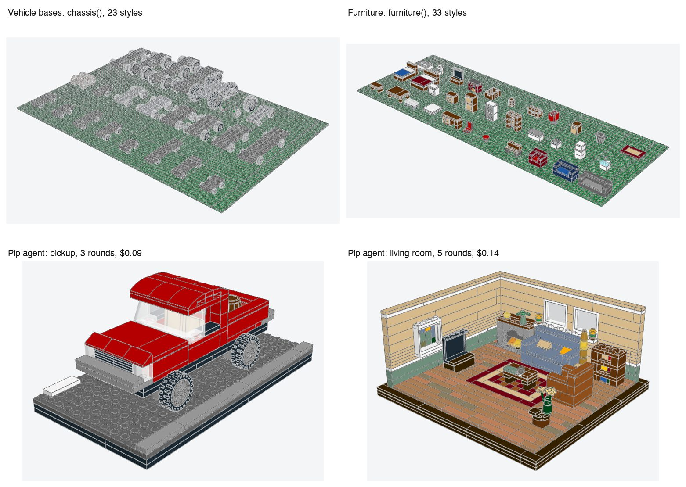

# Fable helpers

A helper is a function a build script calls to get a whole, ready-made piece of a model. The
model writes `roof(0, 19, 0, 14, 10, style="gambrel")` and the kit places a roof whose courses are
each seated on the one below. There are 18 helpers with 381 styles between them.

Only the Pip agent and Fable Thorough v2 are told about helpers. A helper is a shortcut, not a
fence: the prompt tells the model to build by hand whatever no style can make, so a request for a
weeping willow or a roof shape that is not listed still works the slower way it did before.

To add or change one, follow the `fable-helpers` skill (`.agents/skills/fable-helpers/SKILL.md`).

Built by the Pip agent with helpers, for $0.09 to $0.16 of AI spend each:

`chassis()` and `furniture()`, with two Pip builds that use them ($0.09 and $0.14 of AI spend):

## The helpers

| Helper | Builds | Types | Styles |
|---|---|---|---|
| `tree()` | A whole tree, bush or hedge | 19 | round, oak, pine, spruce, fir, christmas, snowy_pine, bush, hedge, topiary, poplar, umbrella, palm, autumn, blossom, birch, apple, orange, bare |
| `roof()` | A whole roof over a rectangle of wall | 26 | gable, steep_gable, a_frame, low_gable, shallow_gable, curved, saltbox, gambrel, barn, mansard, shed, steep_shed, low_shed, hip, low_hip, spire, flat, tiled, parapet, terrace, crenellated, garden, solar, deck, stepped, pagoda |
| `wall()` | A straight wall with window and door openings, each with a lintel | 20 | plain, banded, striped, base, wainscot, crown, masonry, brickwork, log, siding, corrugated, stone, checker, timber, quoins, pilasters, castle, capped, cornice, glass |
| `window()` | A window frame with its glass, or a sheet of glass | 32 | small, diamond, plane, square, arched, arched_lattice, fan, strip, wide, barred, grille, train, picture, french, panorama, deep, skylight, double, triple, ribbon, stacked, grid, tall, transom, arched_pair, shuttered, glass_block, glass_pane, glass_wall, glass_tower, curtain_wall, storefront |
| `door()` | A door frame with its leaf, a garage door, or a car door | 23 | panel, smooth, barred, lattice, doorway, double, double_smooth, glazed, glazed_double, arched, hatch, cabin, train, saloon, car_low, car, car_tall, car_full, garage, garage_wide, garage_tall, barn, shopfront |
| `arch()` | An arch over an opening, on piers if wanted | 16 | flat, small, raised, wide, thick, curved, long, grand, ornate, pointed, gothic, tall_gothic, bow, sweep, buttress, flying_buttress |
| `deck()` | A raised porch, deck or platform with its skirt, railings and steps | 16 | porch, veranda, deck, lattice_deck, patio, terrace, boardwalk, dock, stage, platform, lookout, stoop, loading_dock, pool_deck, garden_deck, bandstand |
| `stairs()` | Steps, a ramp, a staircase or a ladder | 22 | brick, steep, shallow, gentle, porch, tiled, stone, grand, carpet, garden, wooden, open, floating, posts, walled, stoop, landing, ramp, steep_ramp, narrow, prefab, ladder |
| `railing()` | A fence, railing or low wall | 22 | spindled, lattice, lattice_low, ornamental, asian, picket, bar, bar_studs, wide, tall, panel, glass, wall, capped, parapet, battlement, hedge, posts, round_posts, balustrade, bollards, palisade |
| `wheels()` | One axle: two wheels with tyres and what carries them | 20 | small, axle_4, smooth, hubcap, spoked, classic, spoked_axle, classic_axle, outboard_classic, outboard, wagon, medium, sport, street, offroad, truck, big, tall, balloon, caster |
| `chassis()` | The rolling base of a vehicle: a floor with every axle joined under it | 23 | city, hatchback, sedan, classic, kart, limo, van, buggy, cart, trailer, racer, sports, street, suv, pickup, bus, camper, truck, lorry, wide_truck, monster, tractor, hot_rod |
| `windscreen()` | A vehicle windscreen or canopy | 22 | classic, inverted, upright, wide, train, panoramic, low, tall, curved, raked, bus, flat, roll_cage, narrow, sport, canopy, coupe, wide_low, wide_curved, wraparound, bubble, cab |
| `seats()` | Vehicle seats, with a steering wheel for the driver | 16 | single, pair, driver_left, driver_right, front_row_left, front_row_right, sedan_left, sedan_right, cockpit, pilot, tandem, bench, taxi, van, bus, minibus |
| `furniture()` | A piece of furniture, a kitchen or bathroom fitting, or a container | 33 | table, dining_table, coffee_table, pedestal_table, desk, chair, stool, bench, armchair, sofa, long_sofa, bed, double_bed, cupboard, dresser, wardrobe, chest_of_drawers, bookshelf, counter, stove, fridge, sink, bathtub, toilet, tv, fireplace, crate, barrel, chest, mailbox, nightstand, bin, rug |
| `plant()` | A flower, shrub or other small plant | 22 | flower, tulip, daisy, rose, sunflower, bloom, sprout, seedling, bamboo, cactus, cattail, wheat, mushroom, shrub, berry_bush, pumpkin, potted, lily_pad, stump, boxwood, flower_stem, tall_flowers |
| `lamp()` | A street lamp, lantern, torch or traffic light | 16 | street, post, short, bollard, garden, lantern, torch, tiki, candle, traffic_light, uplight, tube, floor, beacon, lighthouse, campfire |
| `chimney()` | A chimney of a given height | 16 | brick, stone, round, capped, pot, twin_pots, crowned, smoking, stack, striped, conical, slim, stovepipe, rain_cap, kiln, modern |
| `column()` | A column or post of a given height | 17 | round, square, pillar, capped, thick, square_thick, doric, banded, totem, spire, obelisk, slender, stand, girder, tapered, pedestal, glass |

Each helper takes `(x, z)` as the min corner of its footprint and `y` as its base in plates, then
its own sizes, a `style`, colors, and usually `facing`. Colors a part is not sold in are replaced
by the closest color it is sold in. A helper that cannot build what was asked raises an error
that says what to change, and places nothing.

## Why these

Three sources decided what became a helper.

**What models got wrong.** In the 42 draft revisions that had errors across seven test builds,
about half were tree canopies, most collisions between shaped parts were roof slopes, and loose
porch steps and an unsupported balcony each cost a build a round. Those became `tree`, `roof`,
`stairs` and `railing`, and the missing lintel became `wall`. The first Pip build with helpers
then spent six of its eight rounds on a porch it had built by hand, so `deck` builds the whole
porch: skirt, floor, railings and steps.

**What customers build.** On 2026-11-25 we read the model files of completed generations made
since 2026-10-15. 4,166 had one, about two thirds of them All parts builds, and 3,439 could
still be downloaded and were read. Only counts and part positions were taken from them; no
customer model, prompt or photo is in this repository.

| Subject, from the prompt or model name | Share of models |
|---|---|
| A building | 21% |
| A car, truck, bus or van | 17% |
| A person or character | 14% |
| An animal or creature | 9% |
| Furniture or an object | 8% |
| A plant or landscape | 5% |
| A plane, spacecraft, train or boat | 7% |
| Not clear from the text (many are image prompts) | 40% |

A model can count under more than one subject. Buildings and vehicles are the two large groups
that are made of repeated structures, so they got the helpers.

How often a kind of part appears, and what that led to:

| Part | Models using it | Helper |
|---|---|---|
| Roof slopes | 36% | `roof` |
| Plants and leaves | 16% | `plant`, `tree` |
| Window frames | 13% | `window` |
| Fences | 13% | `railing` |
| Wheels | 11% | `wheels` |
| Arches | 9% | `arch` |
| Doors | 9% | `door` |
| Seats | 9% | `seats` |
| Windscreens | 7% | `windscreen` |
| Lamp posts | 2% | `lamp` |

**What official sets do.** On 2026-11-25 we downloaded every model in the LDraw.org Official
Model Repository: 1,829 model files of 1,740 official sets, 1.36 million placed parts. We also read
the set and part lists Rebrickable publishes, to see which stocked parts sets use most. Those were
the free sources that allow bulk download. BrickLink has no bulk download of models, and
Rebrickable's fan models need a login and may not be scraped, so neither was used. No downloaded
file is in this repository: only the counts and positions below.

Official sets are where a joint is certain to be right, so they were used three ways.

*To check the first helpers.* The door leaf in its frame, the glass in a small window and the
small wheel on its holder sit in official sets exactly where customers' models put them (the
table below). Three things did not match, and are corrected:

| What official sets show | What was wrong | Now |
|---|---|---|
| A two-pin holder sits centered under a body four studs wide | The four small `wheels()` styles put the holder half a stud to one side, so its studs fell between the grid's | Centered, studs on the grid |
| Wheels on an axle sit one each side of the body | The `truck` style put both wheels three studs to one side | One each side |
| The wide classic tyre is 50 units across | Its note said it reaches 2 plates below the holder; it reaches 2.75, so it sank into the ground | Note and height say 3 |

*To build vehicles the way sets do.* 259 of the sets' models are small vehicles (four or six
wheels, under 400 parts). Their wheels are 3 or 4 studs apart across the car in 58% of them and
their axles 4 to 6 studs apart in 50%; 230 have two axles and 29 have three. The tyres of a small
wheel rise above its holder, so a floor four studs wide cannot lie straight on the holder. Sets put
one plate on the holder and a 2 x 4 mudguard with an arch on that plate (`3788`, `3787` and `60212`
are in 192, 39 and 14 sets; the wheel's middle is 29 to 30 units under the mudguard's top).
`chassis()` builds that, and for wider vehicles the other arrangement sets use: wheels outside
the body on a brick at each side.

*To find what was missing.* Parts that many sets use and no helper did:

| Part | Sets using it | Now in |
|---|---|---|
| Seat `4079` | 219 | `furniture` chair (it was already in `seats`) |
| Low panel 1 x 2 x 1 `4865a` | 223, with a transparent one in 31 | `railing` panel, glass |
| Plate with ladder `4175` | 121 | `stairs` ladder |
| Large rim `56145` with tyres `44309`, `55976`, `15413` | 80 | `wheels` big, balloon, tall |
| Clear panels `87552`, `60581`, `87544`, `59349` | 52, 33, 27, 24 | `window` glass_block, glass_wall, glass_pane, curtain_wall |
| Box with door `4345b` + `4346` | 50 | `furniture` mailbox, nightstand |
| Barrel `2489` | 33 | `furniture` barrel |
| Trolley wheels `2496` | 23 | `wheels` caster |
| Cupboard `92410` with drawers `4536` or door `4533` | 21 | `furniture` cupboard, dresser, wardrobe, desk |
| Flower stem `3741a` with flowers `3742` | 17 | `plant` flower_stem, tall_flowers |
| Crate `30150`, chest `4738a`, bin `92926` | 13, 9, 7 | `furniture` crate, chest, bin |

Leaf parts (`2417`, `2423`) are in 23 and 39 sets but are joined a different way in almost every
one, so
they gave no new tree style: the trees stay plates and bricks.

## Joints that are not stud joints

The checks follow studs. A wheel on a pin, a tyre on a rim, glass in a frame and a door on its
hinges are not stud joints, so a script that guesses where such a part goes gets one that floats
beside the model, and nothing tells it so. The helpers place these parts at the position
customers' models or official sets use most, and record each joint (`kit.attach`, `kit.inset`).
The v2 methods then ask for evidence of every recorded joint: the two parts must touch, and a
Technic pin or axle must lie in a hole of the other part
([docs/fable-agent.md](fable-agent.md#publication-rules-the-v2-methods)). That check found
that the axle wheels (`truck`, `big`, `tall`, `balloon`) recorded their joints between the two
side bricks and between a brick and the far wheel, parts that do not meet, and that a truck four
studs wide got no axle at all. They now record brick to axle and axle to wheel, with an axle
that reaches both rims at every width.

Since then the v2 checks measure most of these joints themselves (`fable_agent/fits.py`): a
pin or axle in a hole, a bar in a clip, a hinge pin, a wheel on its pin, a tyre on its rim. Of
the 332 joints the wheel helper records across its styles, 328 are measured on the real parts.
A helper still records every joint, so that a part the library draws without a peg or a hole
(a pane in its frame, a door on its hinges, a trolley wheel) stays joined.

| Joint | Position used, in the first part's own LDraw units | Seen in |
|---|---|---|
| Door leaf in a 1 x 4 x 6 frame (`60596`) | offset (-32, 0, 5), or (32, 0, 5) turned half way for the other hinge | 470 doors; 45 official sets |
| Wheel `4624` on holder `4600` | (-30, 5, 0) and (30, 5, 0), turned a quarter | 187 wheels |
| Wheel `4624` on holder `2926` | (-50, 5, 0) and (50, 5, 0) | 41 wheels |
| Tyre `87414` on wheel `4624` | same origin | 623 tyres |
| Tyre `18977` on wheel `66727` | (0, 0, -6) | 68 tyres |
| Wheel `13971` or `66727` on pin brick `2458` | (0, 10, -20) | 70 wheels |
| Wheel `55981` on pin brick `2458` | (0, 10, -30), turned half way | 32 wheels |
| Steering wheel `16091` on side-stud brick `87087` | (0, 10, -18), tipped to face the driver | 13 wheels |
| Glass `60601` in window `60592` | same origin | 6,276 panes; 32 official sets |
| Tyre `44309`, `55976` or `15413` on rim `56145` | same origin | 22, 22 and 13 official sets |
| Trolley wheels `2496` in holder `2655` | (0, 14, 0) | 6 official sets |
| Drawer `4536` in cupboard `92410` | (0, 4, 0) and (0, 22, 0) | 13 and 10 official sets |
| Door `4533` on cupboard `92410` | (-24, 4, -17), turned a quarter | 8 official sets |
| Door `4346` on box `4345b` | same origin | 36 official sets |
| Lid `4739` on chest `4738a` | (0, -16, 0) | 5 official sets |
| Flower `3742` on each stalk of stem `3741a` | (0, -17.6, 15), (15.2, -27.3, -8.8), (-14.1, -22.5, -8.1), each leaning out 15 degrees | 11, 10 and 10 official sets |

Three wheel styles (`hubcap`, `spoked`, `classic` and their `_axle` and `outboard` forms) use
wheels made for the same pin, at the position measured for `4624`; that position was not seen
for those wheels themselves. The axle styles (`truck`, `big`, `tall`, `balloon`) put each rim
just clear of the body, which follows the parts' sizes, not a measurement.

Two fits are declared because the checks model a part thicker than it is: the 2 x 2 plate in the
middle of the `60212` mudguard, and the `4175` ladder against its post. Both are how the real
parts go together.

Tyres on a road are a joint too. `wheels()` and `chassis()` look for a part whose top is under
the tyres and join the vehicle to it, so a car on a baseplate is no longer reported as floating.
The road has to be laid before the vehicle.

## How they are kept right

Each construction is written so that every part rests on studs: a roof course starts on the stud
row of the course below, a tree's wide layers are plates that each cross the layer under them, a
stair step is a column from the ground. Two test files hold that:

- `backend/tests/test_fable_helpers.py` runs in CI on stand-in parts of the right size and
  studs. It proves the constructions and the arguments.
- `backend/tests/test_fable_helpers_real.py` builds every style at several sizes and facings
  with the real parts library and catalog, and fails on any overlap, unattached part or
  unstocked part. It is skipped where no parts library is installed, which includes CI.

## Limits

- A helper's parts fit each other. Whether the helper fits the model around it is still the
  model's job: a roof needs walls under its edge, a window an opening of its size.
- Wheels, glass, door leaves and steering wheels are joined by recorded joints the checks do not
  verify.
- A vehicle is joined to a road or baseplate only if that was laid before the vehicle. One built
  by hand, without `wheels()` or `chassis()`, still has to be joined with `connect()`.
- A `chassis()` deck is a whole number of plates above the ground, so its tyres can stand up to
  0.4 plates above or below it.
- Furniture is at a fixed size per style. A wider table or a longer counter is built by hand.
- Flat and stepped roofs span at most 16 studs on their shorter side, the longest plate.
- The styles look alike from build to build. That is the cost of a helper.
