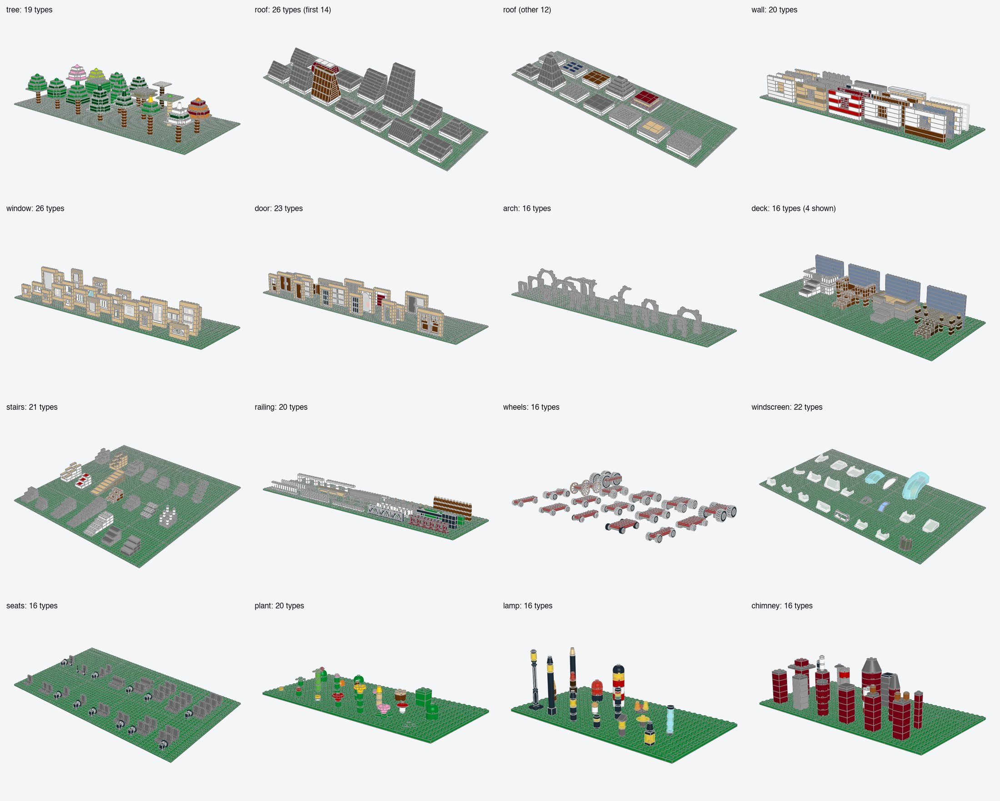
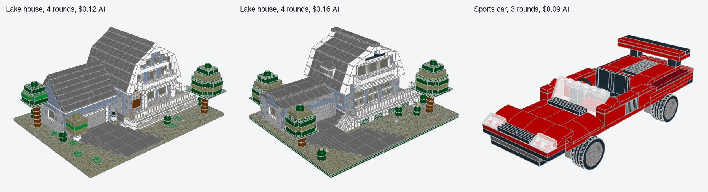

# Fable helpers

A helper is a function a build script calls to get a whole, ready-made piece of a model. The
model writes `roof(0, 19, 0, 14, 10, style="gambrel")` and the kit places a roof whose courses are
each seated on the one below. There are 16 helpers with 310 styles between them.

Only the Pip agent and Fable Thorough v2 are told about helpers. A helper is a shortcut, not a
fence: the prompt tells the model to build by hand whatever no style can make, so a request for a
weeping willow or a roof shape that is not listed still works the slower way it did before.

To add or change one, follow the `fable-helpers` skill (`.agents/skills/fable-helpers/SKILL.md`).

Built by the Pip agent with helpers, for $0.09 to $0.16 of AI spend each:

## The helpers

| Helper | Builds | Types | Styles |
|---|---|---|---|
| `tree()` | A whole tree, bush or hedge | 19 | round, oak, pine, spruce, fir, christmas, snowy_pine, bush, hedge, topiary, poplar, umbrella, palm, autumn, blossom, birch, apple, orange, bare |
| `roof()` | A whole roof over a rectangle of wall | 26 | gable, steep_gable, a_frame, low_gable, shallow_gable, curved, saltbox, gambrel, barn, mansard, shed, steep_shed, low_shed, hip, low_hip, spire, flat, tiled, parapet, terrace, crenellated, garden, solar, deck, stepped, pagoda |
| `wall()` | A straight wall with window and door openings, each with a lintel | 20 | plain, banded, striped, base, wainscot, crown, masonry, brickwork, log, siding, corrugated, stone, checker, timber, quoins, pilasters, castle, capped, cornice, glass |
| `window()` | A window frame with its glass | 26 | small, diamond, plane, square, arched, arched_lattice, fan, strip, wide, barred, grille, train, picture, french, panorama, deep, skylight, double, triple, ribbon, stacked, grid, tall, transom, arched_pair, shuttered |
| `door()` | A door frame with its leaf, a garage door, or a car door | 23 | panel, smooth, barred, lattice, doorway, double, double_smooth, glazed, glazed_double, arched, hatch, cabin, train, saloon, car_low, car, car_tall, car_full, garage, garage_wide, garage_tall, barn, shopfront |
| `arch()` | An arch over an opening, on piers if wanted | 16 | flat, small, raised, wide, thick, curved, long, grand, ornate, pointed, gothic, tall_gothic, bow, sweep, buttress, flying_buttress |
| `deck()` | A raised porch, deck or platform with its skirt, railings and steps | 16 | porch, veranda, deck, lattice_deck, patio, terrace, boardwalk, dock, stage, platform, lookout, stoop, loading_dock, pool_deck, garden_deck, bandstand |
| `stairs()` | Steps, a ramp or a staircase | 21 | brick, steep, shallow, gentle, porch, tiled, stone, grand, carpet, garden, wooden, open, floating, posts, walled, stoop, landing, ramp, steep_ramp, narrow, prefab |
| `railing()` | A fence, railing or low wall | 20 | spindled, lattice, lattice_low, ornamental, asian, picket, bar, bar_studs, wide, tall, wall, capped, parapet, battlement, hedge, posts, round_posts, balustrade, bollards, palisade |
| `wheels()` | One axle: two wheels with tyres and what carries them | 16 | small, axle_4, smooth, hubcap, spoked, classic, spoked_axle, classic_axle, outboard_classic, outboard, wagon, medium, sport, street, offroad, truck |
| `windscreen()` | A vehicle windscreen or canopy | 22 | classic, inverted, upright, wide, train, panoramic, low, tall, curved, raked, bus, flat, roll_cage, narrow, sport, canopy, coupe, wide_low, wide_curved, wraparound, bubble, cab |
| `seats()` | Vehicle seats, with a steering wheel for the driver | 16 | single, pair, driver_left, driver_right, front_row_left, front_row_right, sedan_left, sedan_right, cockpit, pilot, tandem, bench, taxi, van, bus, minibus |
| `plant()` | A flower, shrub or other small plant | 20 | flower, tulip, daisy, rose, sunflower, bloom, sprout, seedling, bamboo, cactus, cattail, wheat, mushroom, shrub, berry_bush, pumpkin, potted, lily_pad, stump, boxwood |
| `lamp()` | A street lamp, lantern, torch or traffic light | 16 | street, post, short, bollard, garden, lantern, torch, tiki, candle, traffic_light, uplight, tube, floor, beacon, lighthouse, campfire |
| `chimney()` | A chimney of a given height | 16 | brick, stone, round, capped, pot, twin_pots, crowned, smoking, stack, striped, conical, slim, stovepipe, rain_cap, kiln, modern |
| `column()` | A column or post of a given height | 17 | round, square, pillar, capped, thick, square_thick, doric, banded, totem, spire, obelisk, slender, stand, girder, tapered, pedestal, glass |

Each helper takes `(x, z)` as the min corner of its footprint and `y` as its base in plates, then
its own sizes, a `style`, colors, and usually `facing`. Colors a part is not sold in are replaced
by the closest color it is sold in. A helper that cannot build what was asked raises an error
that says what to change, and places nothing.

## Why these

Two sources decided what became a helper.

**What models got wrong.** In the 42 draft revisions that had errors across seven test builds,
about half were tree canopies, most collisions between shaped parts were roof slopes, and loose
porch steps and an unsupported balcony each cost a build a round. Those became `tree`, `roof`,
`stairs` and `railing`, and the missing lintel became `wall`. The first Pip build with helpers
then spent six of its eight rounds on a porch it had built by hand, so `deck` builds the whole
porch: skirt, floor, railings and steps.

**What customers build.** On 2026-11-25 we read the model files of completed generations made
since 2026-10-15. 4,166 had one, about two thirds of them All parts builds, and 3,439 could
still be downloaded and were read. Only counts and part positions were taken from them; no
customer model, prompt or photo is in this repository.

| Subject, from the prompt or model name | Share of models |
|---|---|
| A building | 21% |
| A car, truck, bus or van | 17% |
| A person or character | 14% |
| An animal or creature | 9% |
| Furniture or an object | 8% |
| A plant or landscape | 5% |
| A plane, spacecraft, train or boat | 7% |
| Not clear from the text (many are image prompts) | 40% |

A model can count under more than one subject. Buildings and vehicles are the two large groups
that are made of repeated structures, so they got the helpers.

How often a kind of part appears, and what that led to:

| Part | Models using it | Helper |
|---|---|---|
| Roof slopes | 36% | `roof` |
| Plants and leaves | 16% | `plant`, `tree` |
| Window frames | 13% | `window` |
| Fences | 13% | `railing` |
| Wheels | 11% | `wheels` |
| Arches | 9% | `arch` |
| Doors | 9% | `door` |
| Seats | 9% | `seats` |
| Windscreens | 7% | `windscreen` |
| Lamp posts | 2% | `lamp` |

## Joints that are not stud joints

The checks follow studs. A wheel on a pin, a tyre on a rim, glass in a frame and a door on its
hinges are not stud joints, so a script that guesses where such a part goes gets one that floats
beside the model, and nothing tells it so. The helpers place these parts at the position
customers' models use most, and record each joint (`kit.attach`, `kit.inset`), which the build
report lists as declared and not verified.

| Joint | Position used, in the first part's own LDraw units | Seen in |
|---|---|---|
| Door leaf in a 1 x 4 x 6 frame (`60596`) | offset (-32, 0, 5), or (32, 0, 5) turned half way for the other hinge | 470 doors |
| Wheel `4624` on holder `4600` | (-30, 5, 0) and (30, 5, 0), turned a quarter | 187 wheels |
| Wheel `4624` on holder `2926` | (-50, 5, 0) and (50, 5, 0) | 41 wheels |
| Tyre `87414` on wheel `4624` | same origin | 623 tyres |
| Tyre `18977` on wheel `66727` | (0, 0, -6) | 68 tyres |
| Wheel `13971` or `66727` on pin brick `2458` | (0, 10, -20) | 70 wheels |
| Wheel `55981` on pin brick `2458` | (0, 10, -30), turned half way | 32 wheels |
| Steering wheel `16091` on side-stud brick `87087` | (0, 10, -18), tipped to face the driver | 13 wheels |
| Glass `60601` in window `60592` | same origin | 6,276 panes |

Three wheel styles (`hubcap`, `spoked`, `classic` and their `_axle` and `outboard` forms) use
wheels made for the same pin, at the position measured for `4624`; that position was not seen
for those wheels themselves. The `truck` style's axle position follows the part's geometry, not
a measurement.

## How they are kept right

Each construction is written so that every part rests on studs: a roof course starts on the stud
row of the course below, a tree's wide layers are plates that each cross the layer under them, a
stair step is a column from the ground. Two test files hold that:

- `backend/tests/test_fable_helpers.py` runs in CI on stand-in parts of the right size and
  studs. It proves the constructions and the arguments.
- `backend/tests/test_fable_helpers_real.py` builds every style at several sizes and facings
  with the real parts library and catalog, and fails on any overlap, unattached part or
  unstocked part. It is skipped where no parts library is installed, which includes CI.

## Limits

- A helper's parts fit each other. Whether the helper fits the model around it is still the
  model's job: a roof needs walls under its edge, a window an opening of its size.
- Wheels, glass, door leaves and steering wheels are joined by recorded joints the checks do not
  verify.
- A vehicle that stands on its tyres on a base plate is not attached to the plate, and the checks
  say so. That is true of any vehicle, with or without helpers.
- Flat and stepped roofs span at most 16 studs on their shorter side, the longest plate.
- The styles look alike from build to build. That is the cost of a helper.
